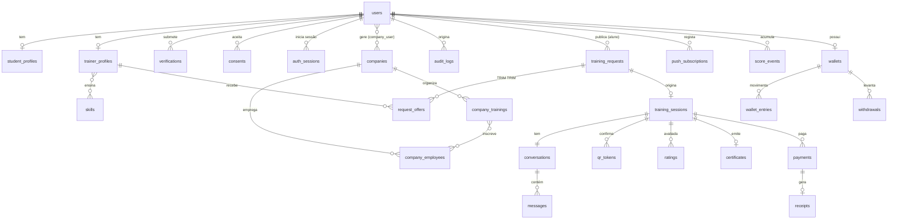

# Base de dados do BISCA

MySQL 8.4, `utf8mb4_unicode_ci`, fuso `Africa/Luanda`. Montantes em **Kz inteiros** (`unsigned int/bigint`).
Localizações: `latitude`/`longitude` (`decimal(10,7)`) como fonte de verdade e uma coluna `location`
`POINT SRID 4326` **gerada** (`ST_SRID(POINT(longitude, latitude), 4326)`, atenção à ordem) com índice `SPATIAL`.
Distâncias com `ST_Distance_Sphere`; pré-filtro com `MBRContains(ST_Buffer(ponto, raio), location)` para usar o índice.

Estado: ✅ criada · 🟡 Fase 2 · ⚪ fases seguintes (desenho provisório).

## Diagrama

## Tabelas

### Identidade (Fase 1)

| Tabela | | Colunas principais | Índices / notas |
|---|---|---|---|
| `users` | ✅ | phone (E.164), phone_verified_at, name, email?, status (active/suspended), locale, last_login_at, onboarded_at, soft deletes | phone único, email único, status |
| `roles`, `permissions`, `model_has_roles`… | ✅ | spatie/laravel-permission | papéis: student, trainer, company_rh, admin |
| `student_profiles` | ✅ | user_id, municipality, neighborhood, education_level | user_id único |
| `trainer_profiles` | ✅ | user_id, bio, years_experience, modalities, rate_amount/rate_unit, municipality, neighborhood, latitude, longitude, **location (gerada)**, service_radius_m, verification_status, score (0–100), badges, is_available, onboarding_completed_at | SPATIAL(location), (verification_status, is_available) |
| `skills` / `skill_trainer_profile` | ✅ | name, slug, category, active | slug único; pivot com PK composta |
| `companies` | ✅ | name, nif?, sector, municipality, neighborhood, address, phone, email, status, created_by, soft deletes | nif único |
| `company_user` | ✅ | company_id, user_id, role (owner/manager) | gestores RH |
| `company_employees` | ✅ | company_id, user_id?, name, phone, email, department, job_title, status | (company_id, phone) único |
| `verifications` | ✅ | user_id, type, status, **document_number (cifrado)**, document_hash (HMAC), documents (disco privado), reviewed_by/at, rejection_reason | o nº do BI nunca sai na API por defeito |
| `consents` | ✅ | user_id, type, version, accepted_at, revoked_at, ip, user_agent | (user_id, type) |
| `otp_codes` | ✅ | phone, code_hash, purpose, attempts, expires_at, consumed_at, ip | phone, expires_at |
| `auth_sessions` | ✅ | uuid, user_id, type (web/api), device_name, ip, user_agent, access/refresh token ids, last_active_at, revoked_at | lista e revogação de sessões |
| `audit_logs` | ✅ | user_id, action, subject (morph), ip, user_agent, request_id, metadata | append-only |

### Pedidos, matching e aulas (Fase 2)

| Tabela | | Colunas principais | Índices / notas |
|---|---|---|---|
| `training_requests` | ✅ | student_id, skill_id, title, description, amount, commission, trainer_net, scheduled_at, modality, municipality, neighborhood, latitude, longitude, **location (gerada)**, state, wave, expires_at, next_wave_at, matched_at, assigned_trainer_profile_id, cancelled_by/reason/at, republished_from_id | SPATIAL(location), (state, expires_at), (state, next_wave_at), (student_id, state) |
| `request_offers` | ✅ | training_request_id, trainer_profile_id, wave, rank, distance_m, score_snapshot, state, sent_at, viewed_at, expires_at, responded_at, **accepted_request_id (gerada)** | (request, trainer) único; **accepted_request_id único** (no máximo uma oferta aceite por pedido); (state, expires_at); (trainer_profile_id, state) |
| `training_sessions` | ✅ | training_request_id, student_id, trainer_profile_id, skill_id, title, amount, commission, trainer_net, scheduled_at, modality, local exato, state, escrow_reference | training_request_id **único**; (trainer_profile_id, state, scheduled_at) para conflitos de horário |
| `conversations` / `messages` | ✅ | training_session_id (único); conversation_id, sender_id, body, attachment_path/name/size, client_id | (conversation_id, id); (conversation, sender, client_id) único para reenvios idempotentes |
| `push_subscriptions` | ✅ | subscribable (morph), endpoint, public_key, auth_token, content_encoding, device, last_used_at | endpoint único |
| `notifications` | ✅ | padrão do Laravel (uuid, type, notifiable, data, read_at) | notificações na app |
| `score_events` | ✅ | trainer_profile_id, type, points (0 nesta fase), subject (morph), metadata | (trainer_profile_id, type, created_at) |

### Fases seguintes (provisório)

| Tabela | Fase | Notas |
|---|---|---|
| `qr_tokens` | 3 | token assinado de curta duração por aula; confirma presença e liberta o pagamento |
| `payments` | 3 | aula, método (Multicaixa Express, referência, dinheiro), montante, estado, referência externa, idempotency_key |
| `receipts` | 3 | número sequencial (LNG-AAAAMMDD-NNNNN), pagamento, PDF, código de validação público |
| `wallets` / `wallet_entries` | 3 | razão de dupla entrada: retido (escrow), disponível, comissão; nunca apagar movimentos |
| `withdrawals` | 3 | levantamentos (Multicaixa Express, banco), estado e comprovativo |
| `ratings` | 3 | avaliação mútua 1–5 + comentário, uma por parte e por aula |
| `certificates` | 3 | aula/formação, código público, PDF, hash para validação em longa.ao/validar |
| `company_trainings` (+ pivot com funcionários) | 4 | formação em massa, presenças por dia, certificados individuais |
