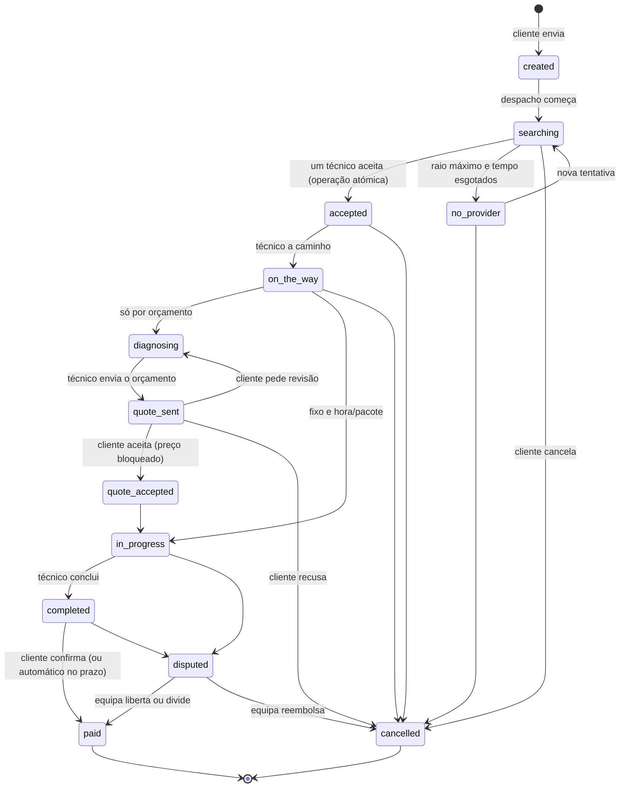
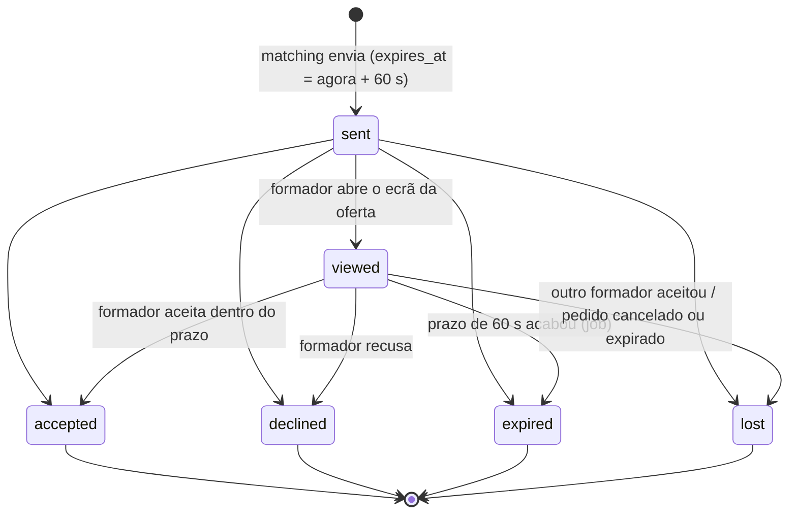

# Máquinas de estados

As transições estão definidas nos enums (`transitions()`), e são aplicadas só por
`HasStateMachine::transitionTo()`:

1. a transição tem de ser permitida pelo enum, senão dá `409 invalid_state_transition`;
2. a gravação é um `UPDATE … WHERE state = <estado atual>`. Se outro processo (job ou pedido HTTP)
   tiver mudado o estado entretanto, nada é gravado e dá `409 state_changed`.

Por isso nenhuma transição inválida acontece, nem pela API nem pelos jobs, e duas transições
concorrentes nunca são aplicadas as duas. Cobertura: `tests/Feature/Requests/StateMachineTest.php`
(matriz completa de pares de estados).

## Pedido de serviço (`service_requests.state`) — estado único do BISCA

O pedido tem um só estado, do envio ao pagamento. Cada mudança fica em `service_request_transitions`
(de, para, quem, quando, motivo; só acréscimos). Para indicar quem fez a mudança: `$request->by($user, 'motivo')`;
sem isso fica o utilizador autenticado, e `by(null)` regista o sistema (jobs e prazos).



Regra do modo de preço (`ServiceRequest::transitionAllowed()`, com `service_requests.pricing_mode` copiado da
categoria no envio):
- `diagnosing`, `quote_sent` e `quote_accepted` só existem nos serviços **por orçamento**;
- nesses, `on_the_way → in_progress` é recusado (tem de haver diagnóstico e orçamento aceite).

**Republicar** um pedido `no_provider` ou `cancelled` cria um **pedido novo** (`republished_from_id` aponta para o
original).

## Oferta TRIM TRIM (`request_offers.state`)



- O prazo é sempre do servidor: aceitar exige `now() < expires_at`, mesmo que o job de expiração ainda não tenha corrido. O cliente só mostra a contagem.
- Uma coluna gerada `accepted_request_id` com índice único garante, na própria BD, **no máximo uma oferta `accepted` por pedido**; `training_sessions.training_request_id` também é único.
- Recusar (`declined`) e deixar expirar (`expired`) registam um `score_event`.

## Execução do pedido (o serviço é o próprio pedido)

Desde a Fase 2 não há tabela de aulas/trabalhos: a execução fica no pedido (`service_requests`), com o estado único
acima. Detalhes que não são estados:

- **`payment_status`** (pagamento digital): `pending` depois de aceite e até o cliente pagar (janela de 10 min),
  `held` quando o valor está retido (escrow), `failed` quando o prazo acabou ou o pagamento foi recusado. Em
  dinheiro fica `null`. O técnico só pode iniciar sem pagamento pendente.
- **`closed_reason`** (porque terminou sem pagamento normal): `payment_failed`, `cancelled_by_client`,
  `cancelled_by_provider`, `no_show_provider`, `no_show_client`, `not_started`, `refunded`.
- Cada transição passa por `SessionLifecycle::transition()`: grava o histórico do pedido (quem, evento) e um
  `session_event` com os detalhes (QR, pagamento, sinais de risco), na mesma transação.
- `ends_at` = início + `duration_minutes`. Conflitos de horário no despacho: pedidos do técnico em
  `RequestState::occupying()` (aceite até em execução) que se sobreponham, com 30 min de folga.

| Ação | De | Para |
|---|---|---|
| Técnico inicia | `accepted` / `on_the_way` / `quote_accepted` | (`on_the_way` →) `in_progress` |
| Técnico conclui e mostra o QR | `in_progress` | `completed` (começa a janela de confirmação) |
| Cliente lê o QR, o código ou confirma sem QR | `completed` (ou `in_progress`, que passa a `completed`) | `paid` |
| Cliente ou técnico cancela antes de começar | `accepted` / `on_the_way` | `cancelled` (`cancelled_by_*`), com a política de reembolso |
| Reportar falta | `accepted` / `on_the_way` | `cancelled` (`no_show_*`), dinheiro retido até ao fim do prazo de contestação |

### Regras automáticas (config `longa.session_rules`)

| Regra | Quando | Efeito |
|---|---|---|
| R1 | Ainda `accepted`/`on_the_way` 2 h após o fim previsto | → `cancelled` (`not_started`); o técnico pode contestar em 24 h; sem contestação, reembolso total |
| R2 | `in_progress` 2 h após o fim previsto (sem QR) | → `completed`; 48 h para o cliente confirmar ou disputar; sem resposta → `paid` e libertação |
| R3 | Pagamento `pending` com o prazo vencido | → `cancelled` (`payment_failed`); técnico libertado |
| R4 | Falta reportada (ou R1) | 24 h para contestar (abre disputa); sem contestação, liquidação conforme a política |
| R5 | Dinheiro: `paid` sem confirmação do pagamento em mão em 48 h | assume-se pago e regista-se a comissão em dívida |

## Despacho presencial (rondas de raio crescente)

```mermaid
sequenceDiagram
    participant C as Cliente
    participant S as Servidor
    participant T as Técnicos
    C->>S: enviar pedido
    S->>T: ronda 1: técnicos a ≤ 3 km (ordem: proximidade e reputação)
    alt alguém aceita
        T->>S: aceitar (atómico, o primeiro ganha)
        S-->>C: RequestMatched
        S-->>T: restantes: oferta perdida
    else ninguém aceita em 12 min
        S->>T: ronda 2: técnicos novos a ≤ 6 km (as ofertas da ronda 1 continuam abertas)
    end
    Note over S: + 3 km por ronda até 15 km; depois continua a 15 km com quem ficar disponível
    S-->>C: ao fim de 1 h: "sem técnico disponível" (tentar de novo ou republicar)
```

- Parâmetros (Definições → Despacho): raio inicial 3 km, alargamento 3 km, raio máximo 15 km, tempo de procura
  60 min (repartido pelas rondas: 5 × 12 min), saldo mínimo 0 Kz (desligado até à Fase 3), até 25 técnicos novos
  por ronda (`longa.matching.round_size`).
- Elegível: verificado, disponível, com a categoria e a modalidade, sem outro serviço à mesma hora, dentro do raio
  da ronda e do raio de atuação dele, e com saldo ≥ saldo mínimo quando ligado.
- Se ninguém puder servir o pedido nem no raio máximo, o pedido passa logo a "sem técnico disponível".
- A notificação diz o serviço, a distância e quanto o técnico recebe (valor − comissão dele; "por orçamento" nos
  orçamentos).
- **Nova tentativa** (`POST /api/v1/service-requests/{id}/retry`): `no_provider → searching` com nova janela de
  procura; as ofertas sem resposta voltam a `sent` (as recusadas ficam recusadas) e as rondas recomeçam.
- **Online:** sem perímetro; o pedido é oferecido de uma vez aos técnicos da categoria que fazem online. O serviço é
  agendado e há lembretes ao cliente e ao técnico 24 h e 1 h antes (regra `reminders_before`).

## Disputas

| Quem abre | Quando | Efeito |
|---|---|---|
| Cliente ou técnico | pedido `in_progress` ou `completed` | pedido → `disputed`, retenção → `disputed` |
| Parte acusada de faltar (ou técnico em `not_started`) | pedido `cancelled` por falta e dentro de `no_show_contest_until` (24 h) | o pedido fica `cancelled`; a disputa retém o dinheiro até à decisão |

- Uma só disputa aberta por pedido (repetir devolve a mesma). As regras automáticas ignoram pedidos com disputa.
- Evidências: até 5 ficheiros JPG/PNG/WebP/PDF de 5 MB cada (tipo verificado pelo conteúdo), no disco privado;
  acesso por link assinado de 10 minutos, só participantes e equipa.
- Decisão só pelo admin (`POST /api/v1/admin/disputes/{id}/resolve`, nota obrigatória, auditada):
  `released` → `paid`, `partially_refunded` (parte do técnico entre 1 Kz e valor − 1) → `paid`, `refunded` →
  `cancelled` (`refunded`). Numa contestação de falta só se move o dinheiro. Disputa e pedido são bloqueados
  (`FOR UPDATE`); uma segunda decisão diferente recebe 409 `dispute_already_resolved` e não move dinheiro.

## Pedidos para outro dia (agendados)

Um pedido é **agendado** quando a aula não é hoje (hora de Angola) e o fecho ainda está longe.

| | Hoje (TRIM TRIM) | Outro dia (agendado) |
|---|---|---|
| Quem recebe | formadores a 5 km, em ondas (10, depois 15), VIP primeiro | formadores a 5 km **e** VIP da mesma província, todos de uma vez |
| Prazo da oferta | 60 s | até ao fecho do pedido |
| Fecho do pedido | 5 min | X h antes da aula (Definições, por omissão 2 h) |
| Sem candidatos | expira logo | espera; a cada 10 min entram formadores que ficaram elegíveis |
| Notificação | push (SMS se não houver push) | push para os primeiros 50 (VIP primeiro), sem SMS; os outros veem em "Pedidos agendados" |
| Oferta que vence | conta para a pontuação | não penaliza |

O aceitar é o mesmo nos dois casos (bloqueio do pedido: só um formador fica com a aula).

