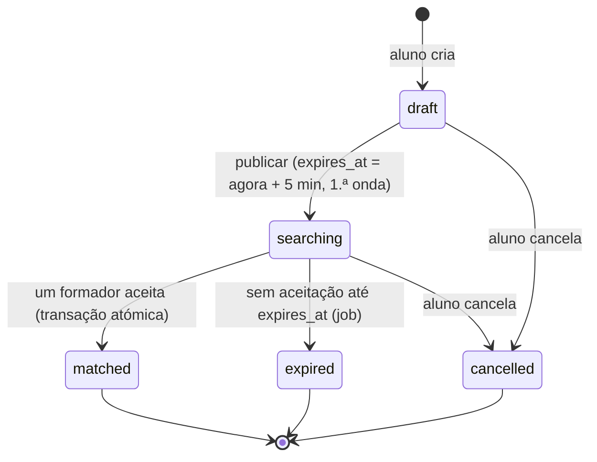
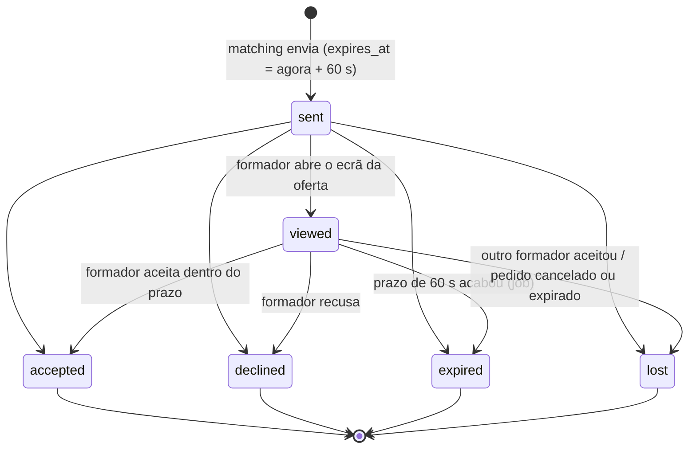
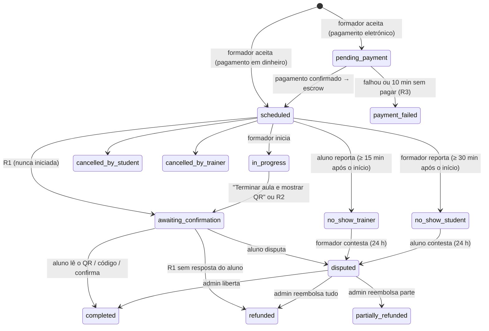
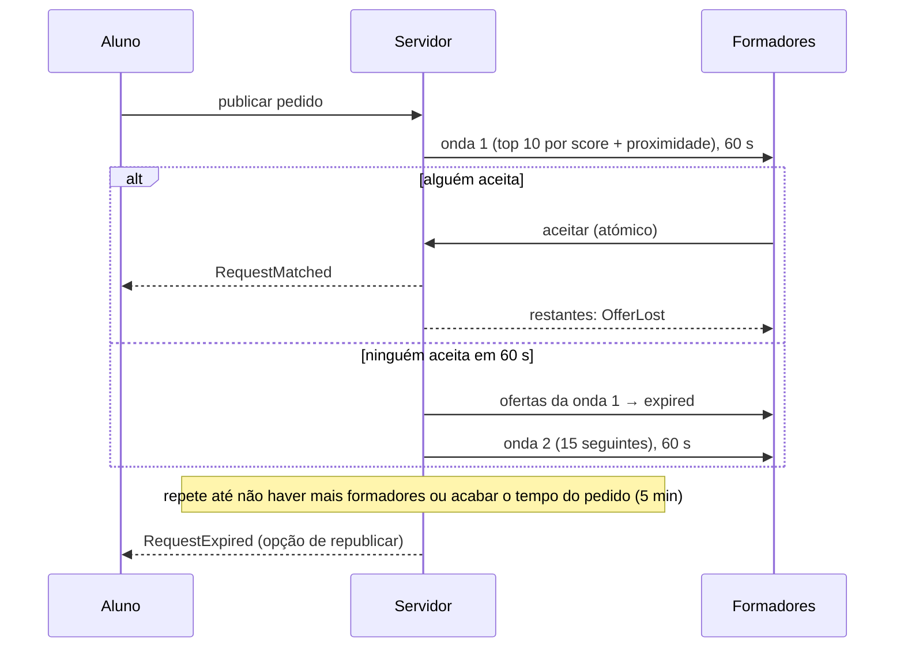

# Máquinas de estados

As transições estão definidas nos enums (`transitions()`), e são aplicadas só por
`HasStateMachine::transitionTo()`:

1. a transição tem de ser permitida pelo enum, senão dá `409 invalid_state_transition`;
2. a gravação é um `UPDATE … WHERE state = <estado atual>`. Se outro processo (job ou pedido HTTP)
   tiver mudado o estado entretanto, nada é gravado e dá `409 state_changed`.

Por isso nenhuma transição inválida acontece, nem pela API nem pelos jobs, e duas transições
concorrentes nunca são aplicadas as duas. Cobertura: `tests/Feature/Requests/StateMachineTest.php`
(matriz completa de pares de estados).

## Pedido de aula (`training_requests.state`)

| De | Para | Quem / quando | Efeitos |
|---|---|---|---|
| draft | searching | aluno publica | `expires_at`, onda 1 enviada, `next_wave_at` |
| draft | cancelled | aluno | — |
| searching | matched | formador aceita | aula criada, conversa criada, restantes ofertas → `lost`, escrow `hold()` (mock) |
| searching | expired | job `ExpireRequests`, quando `expires_at` passa e já não há ofertas abertas nem ondas | ofertas abertas → `lost`; aluno notificado com opção de republicar |
| searching | cancelled | aluno | ofertas abertas → `lost`; formadores notificados |

**Republicar** um pedido `expired` ou `cancelled` cria um **pedido novo** (`republished_from_id` aponta para o original).

## Oferta TRIM TRIM (`request_offers.state`)

- O prazo é sempre do servidor: aceitar exige `now() < expires_at`, mesmo que o job de expiração ainda não tenha corrido. O cliente só mostra a contagem.
- Uma coluna gerada `accepted_request_id` com índice único garante, na própria BD, **no máximo uma oferta `accepted` por pedido**; `training_sessions.training_request_id` também é único.
- Recusar (`declined`) e deixar expirar (`expired`) registam um `score_event`.

## Aula (`training_sessions.state`)

- Todas as transições passam por `SessionLifecycle::transition()`, que grava um `session_event` (de, para,
  ator, metadados) na mesma transação. Ninguém (API, job ou admin) consegue uma transição fora do diagrama.
- Estados finais: `payment_failed`, `completed`, `cancelled_by_student`, `cancelled_by_trainer`, `refunded`,
  `partially_refunded`. As faltas ficam em aberto 24 h para contestação; sem contestação são liquidadas pelo job.
- O fim previsto (`ends_at`) = início + `duration_minutes` (por defeito 60). Conflitos de horário no matching:
  aulas em `pending_payment`, `scheduled` ou `in_progress` que se sobreponham, com 30 min de folga.

### Regras automáticas (config `longa.session_rules`)

| Regra | Quando | Efeito | Risco aluno / formador |
|---|---|---|---|
| R1 | Aula ainda `scheduled` 2 h após o fim previsto | → `awaiting_confirmation` (não iniciada); 48 h para o aluno confirmar ou disputar; sem resposta → `refunded` (100%) | baixo / perde se esquecer de iniciar e o aluno não confirmar |
| R2 | Aula `in_progress` 2 h após o fim previsto (sem QR) | → `awaiting_confirmation`; 48 h para o aluno confirmar ou disputar; sem resposta → `completed` e libertação | perde se esquecer de responder (lembretes às 24 h e 47 h) / baixo |
| R3 | `pending_payment` há 10 min | → `payment_failed`; formador libertado | — / perde a oferta |
| R4 | Falta reportada | a outra parte tem 24 h para contestar (→ `disputed`); sem contestação, liquidação conforme a política | falsas acusações → disputa |

## Ondas do matching

## Disputas

| Quem abre | Quando | Efeito |
|---|---|---|
| Aluno | aula em `awaiting_confirmation` | aula → `disputed`, retenção → `disputed` |
| Parte acusada de faltar | `no_show_*` e dentro de `no_show_contest_until` (24 h) | idem |

- Uma só disputa aberta por aula (repetir devolve a mesma). As regras automáticas (R1–R5) ignoram aulas `disputed`.
- Evidências: até 5 ficheiros JPG/PNG/WebP/PDF de 5 MB cada (tipo verificado pelo conteúdo), no disco privado;
  acesso por link assinado de 10 minutos, só participantes e admin.
- Decisão só pelo admin (`POST /api/v1/admin/disputes/{id}/resolve`, nota obrigatória, auditada):
  `released` → `completed`, `refunded` → `refunded`, `partially_refunded` (parte do formador entre 1 Kz e valor − 1) →
  `partially_refunded`. Disputa e aula são bloqueadas (`FOR UPDATE`); uma segunda decisão diferente recebe 409
  `dispute_already_resolved` e não move dinheiro. A liquidação usa a chave de ledger `escrow:settle:session:{id}`.
