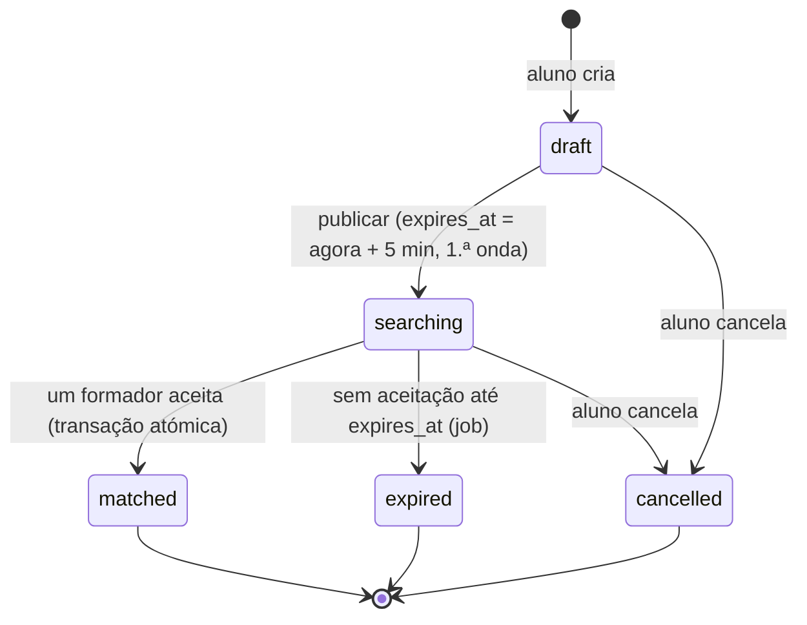
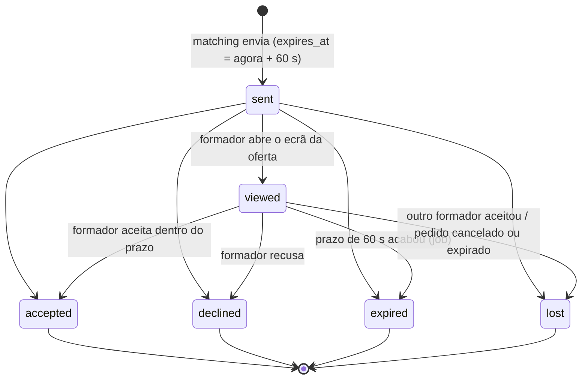
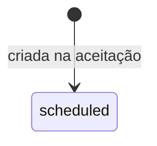
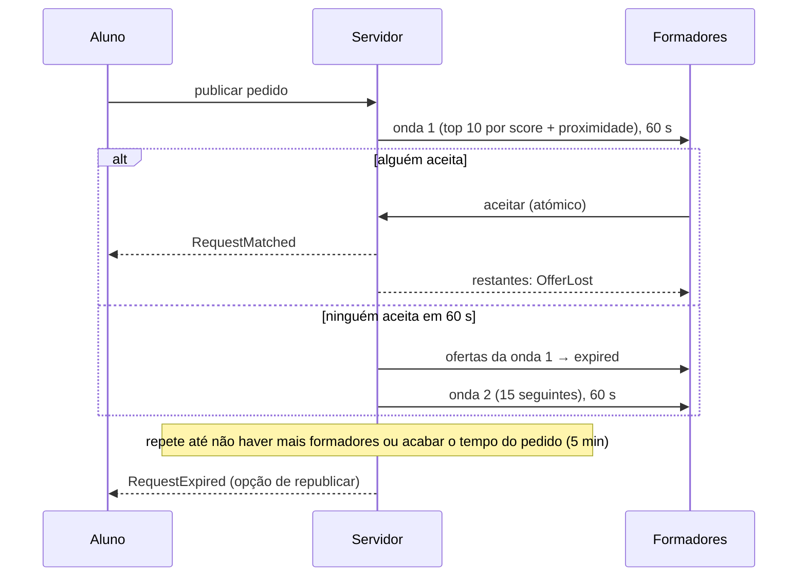

# Máquinas de estados

As transições estão definidas nos enums (`transitions()`), e são aplicadas só por
`HasStateMachine::transitionTo()`:

1. a transição tem de ser permitida pelo enum, senão dá `409 invalid_state_transition`;
2. a gravação é um `UPDATE … WHERE state = <estado atual>`. Se outro processo (job ou pedido HTTP)
   tiver mudado o estado entretanto, nada é gravado e dá `409 state_changed`.

Por isso nenhuma transição inválida acontece, nem pela API nem pelos jobs, e duas transições
concorrentes nunca são aplicadas as duas. Cobertura: `tests/Feature/Requests/StateMachineTest.php`
(matriz completa de pares de estados).

## Pedido de aula (`training_requests.state`)

| De | Para | Quem / quando | Efeitos |
|---|---|---|---|
| draft | searching | aluno publica | `expires_at`, onda 1 enviada, `next_wave_at` |
| draft | cancelled | aluno | — |
| searching | matched | formador aceita | aula criada, conversa criada, restantes ofertas → `lost`, escrow `hold()` (mock) |
| searching | expired | job `ExpireRequests`, quando `expires_at` passa e já não há ofertas abertas nem ondas | ofertas abertas → `lost`; aluno notificado com opção de republicar |
| searching | cancelled | aluno | ofertas abertas → `lost`; formadores notificados |

**Republicar** um pedido `expired` ou `cancelled` cria um **pedido novo** (`republished_from_id` aponta para o original).

## Oferta TRIM TRIM (`request_offers.state`)

- O prazo é sempre do servidor: aceitar exige `now() < expires_at`, mesmo que o job de expiração ainda não tenha corrido. O cliente só mostra a contagem.
- Uma coluna gerada `accepted_request_id` com índice único garante, na própria BD, **no máximo uma oferta `accepted` por pedido**; `training_sessions.training_request_id` também é único.
- Recusar (`declined`) e deixar expirar (`expired`) registam um `score_event`.

## Aula (`training_sessions.state`)

Nesta fase só existe `scheduled`. A Fase 3 acrescenta a confirmação por QR, a conclusão, o cancelamento e a falta.

## Ondas do matching

